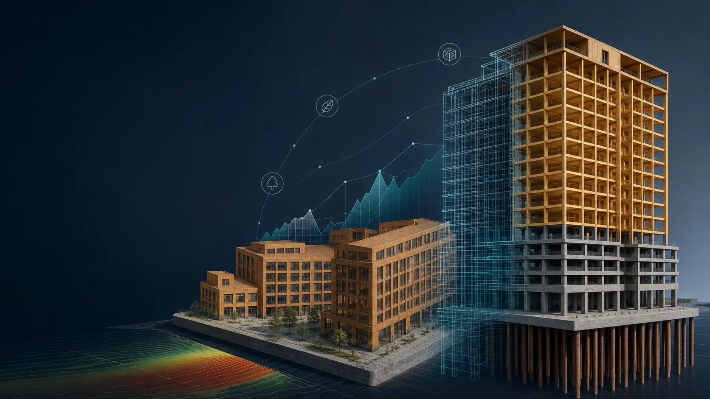
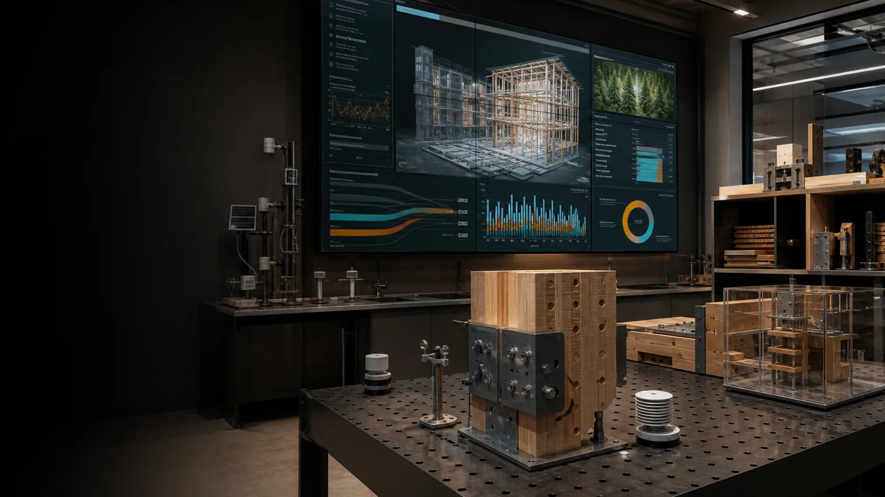
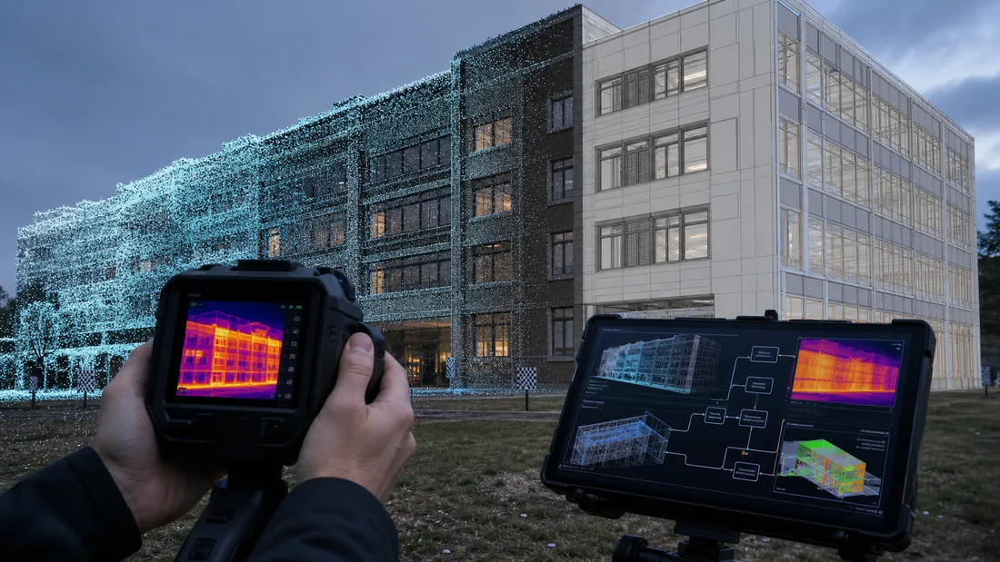
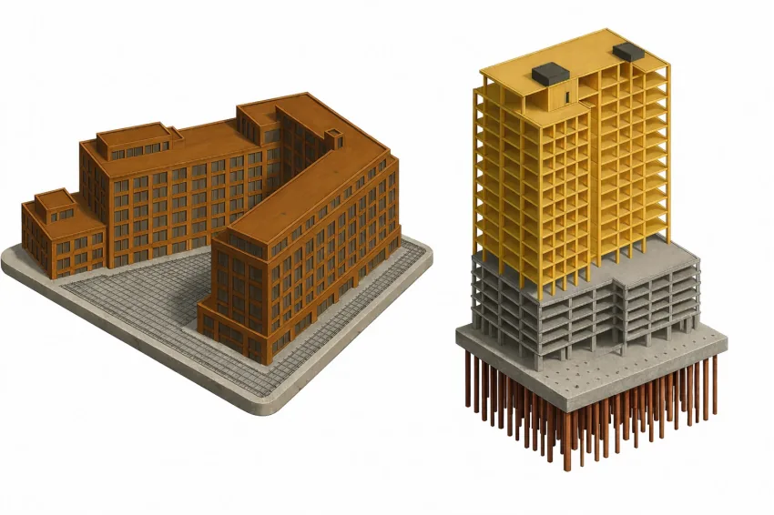
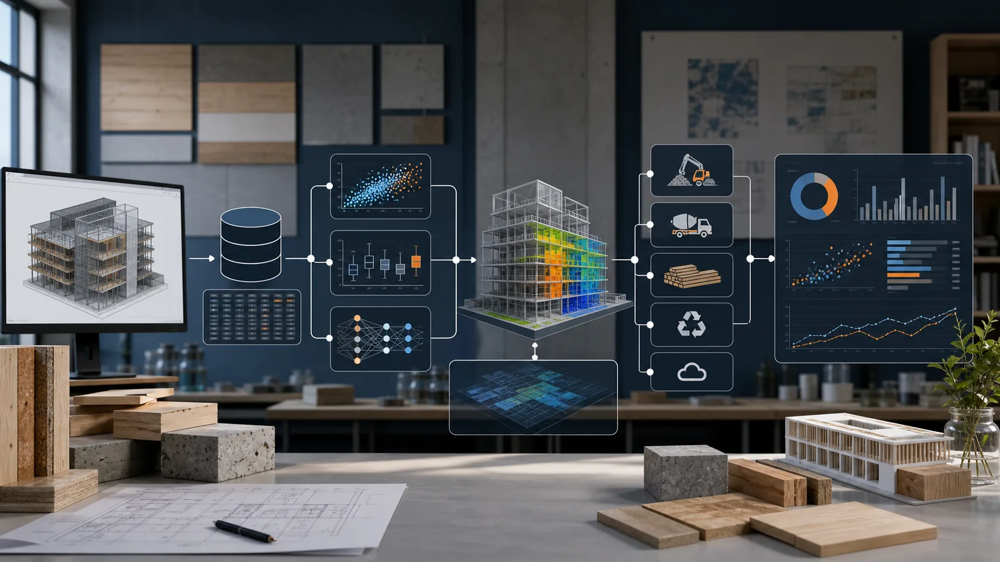
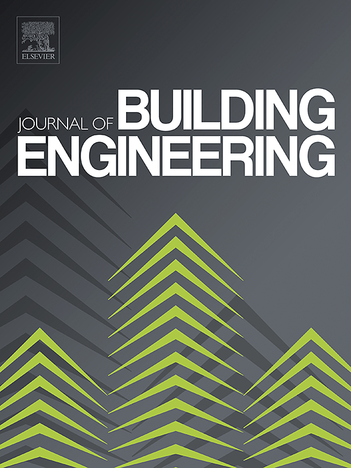
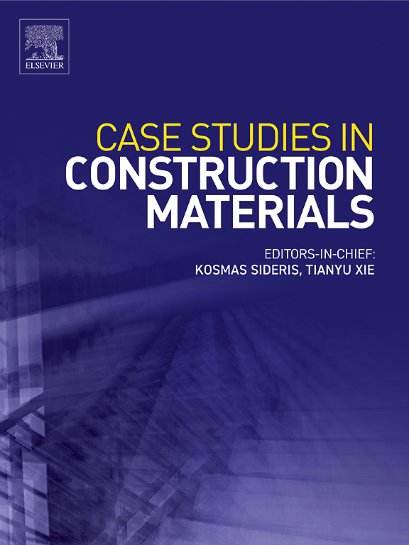
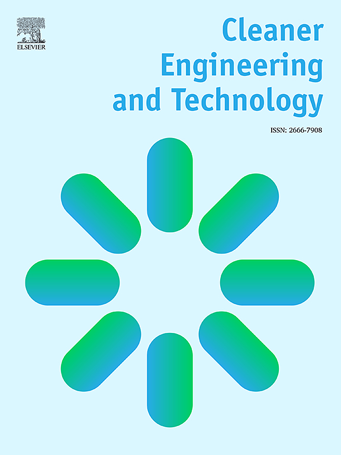

<section class="hero-shell" id="about-me">
  

    
    
    
    

  

  

  

  

  

    
Baowen Zhang / Assistant Professor of Construction Management

    

      <h1 class="hero-title">
        Turning building data
        into <em>lower-carbon</em>
        decisions.
      </h1>

      

        
I bring machine learning, digital twins, energy modeling, and carbon accounting together so construction and retrofit teams can measure what matters before they build.

        

          <a class="btn btn--primary" href="#experience">Explore Research <i class="fas fa-arrow-right" aria-hidden="true"></i></a>
          <a class="btn btn--ghost" href="/Baowen_Zhang_CV.pdf" target="_blank" rel="noopener">Curriculum Vitae</a>
        

      

    

    

      

        <a href="#experience">01 Energy Forecasting</a>
        <a href="#experience">02 Digital Twins</a>
        <a href="#experience">03 Embodied Carbon</a>
      

      

        <button class="hero-motion-toggle" type="button" aria-label="Pause background motion" aria-pressed="false">
          <i class="fas fa-pause" aria-hidden="true"></i>
        </button>
        <a class="hero-scroll" href="#profile" aria-label="Scroll to profile">
          Scroll
          <i class="fas fa-arrow-down" aria-hidden="true"></i>
        </a>
      

    

  

</section>

  

    

      Energy ForecastingDigital TwinsEmbodied CarbonMass TimberLife-Cycle AssessmentIFC &amp; OpenBIMLocal Law 97Machine LearningEnergyPlusLow-Carbon Concrete
    

  

<section class="section-band profile" id="profile">
  

    
01Profile

    <h2>Building better decisions from the data construction <em>already creates.</em></h2>
    
I am an Assistant Professor of Construction Management at Colorado State University Pueblo. My work sits at the intersection of building science, construction operations, and computation, where I develop practical ways to quantify energy, carbon, cost, and performance early, before they turn into expensive decisions in the field.

    
My projects range from machine-learning models for urban retrofits to digital-twin workflows and construction-stage energy assessment for mass timber. What connects them is a simple test: the work should outlive the paper and prove useful in classrooms, on project teams, and in the built environment.

  

  <figure class="profile-portrait">
    

      
    

    <figcaption><strong>Baowen Zhang, Ph.D.</strong>Assistant Professor of Construction Management</figcaption>
  </figure>

  

    

      
Current Focus

      
Forecasting urban retrofits, automating IFC-to-energy pipelines, and accounting for carbon in timber construction.

    

    

      
Methods

      
Machine learning, energy modeling, BIM, IFC, LCA, computational design, SQL, and decision-support analytics.

    

    

      

        
Google Scholar

        <a href="https://scholar.google.com/citations?user=ATUYvjoAAAAJ&hl=en&oi=ao" target="_blank" rel="noopener">Live profile <i class="fas fa-arrow-right" aria-hidden="true"></i></a>
      

      

        
--Citations

        
--h-index

        
--i10-index

      

      
Updated --

    

  

</section>

<section class="section-band news" id="news">
  

    
02Recent News

  

  <ol class="timeline">
    <li class="timeline__item">
      
Dec 2026

      
Invited to present my ongoing research on concrete EPDs, embodied-carbon benchmarking, and concrete procurement at the New York State Embodied Carbon Working Group's meeting.

    </li>
    <li class="timeline__item">
      
Oct 2026

      
My first-authored study on construction-stage energy use in mass timber buildings was featured in the USDA Forest Service's <em>Rooted in Research</em> newsletter during National Forest Products Week.

    </li>
    <li class="timeline__item">
      
Oct 2026

      
Published a multicriteria sustainability analysis of concrete designed to maximize the use of local waste materials, in <em>Cleaner Engineering and Technology</em>.

    </li>
    <li class="timeline__item">
      
Jul 2026

      
Published a dual-track framework for quantifying construction-stage energy use in mass timber buildings, in <em>Case Studies in Construction Materials</em>.

    </li>
    <li class="timeline__item">
      
Jun 2026

      
Published a machine-learning decision-support framework that prioritizes multifamily energy retrofits on economic grounds under New York City's Local Law 97, in the <em>Journal of Building Engineering</em>.

    </li>
    <li class="timeline__item">
      
Jan 2026

      
Joined Colorado State University Pueblo as an Assistant Professor of Construction Management.

    </li>
    <li class="timeline__item">
      
Dec 2025

      
Completed my Ph.D. in Sustainable Construction Management and Wood Science at SUNY-ESF.

    </li>
  </ol>
</section>

<section class="section-band" id="experience">
  

    
03Research Focus

    <h2>Research built on three threads: forecasting, digital infrastructure, and <em>decarbonization.</em></h2>
  

  

    <article class="feature-card feature-card--visual">
      

        
        01
        <i class="fas fa-bolt" aria-hidden="true"></i>
      

      

        <h3>Urban Energy Retrofit and LL97</h3>
        
Machine-learning models that rank energy conservation measures for multifamily buildings under New York City's Local Law 97.

      

    </article>
    <article class="feature-card feature-card--visual">
      

        
        02
        <i class="fas fa-draw-polygon" aria-hidden="true"></i>
      

      

        <h3>AI-Assisted Digital Twin and IFC Workflows</h3>
        
Semantic IFC pipelines that use point-cloud capture, handheld thermography, and AI agents to produce EnergyPlus-ready models.

      

    </article>
    <article class="feature-card feature-card--visual">
      

        
        03
        <i class="fas fa-seedling" aria-hidden="true"></i>
      

      

        <h3>Construction-Stage Energy and Embodied Carbon</h3>
        
A dual-track A5 assessment for mass-timber and hybrid buildings, paired with material and life-cycle carbon research.

      

    </article>
  

</section>

<section class="projects-band" id="projects">
  

  

    

      
04Projects

      <h2>The projects shaping the <em>current arc</em> of my work.</h2>
    

    

      <article class="project-item">
        
A

        <h3>IFC-Based Digital Twin for Automated Energy Modeling</h3>
        
I built workflows that enrich IFC models with thermal and HVAC semantics, link Rhino and Grasshopper to EnergyPlus, and feed field measurements back into the digital model for existing-building analysis.

      </article>
      <article class="project-item">
        
B

        <h3>Sustainable Materials, Low-Carbon SCMs, and Mass-Timber LCA</h3>
        
I evaluated high-replacement blended concretes and timber systems through mechanical testing, techno-economic analysis, and cradle-to-gate life-cycle assessment.

      </article>
      <article class="project-item">
        
C

        <h3>Stochastic Modeling for Infrastructure Asset Management</h3>
        
I developed AHP-Markov deterioration models that help infrastructure owners forecast service life and direct maintenance resources where they matter most.

      </article>
    

  

</section>

<section class="section-band" id="toolbox">
  

    

      
05Research Methods

      <h2>Computational methods and technical infrastructure for <em>reproducible</em> building research.</h2>
    

    
Field observations, semantic building data, simulation, machine learning, and life-cycle evidence come together in workflows that can be traced from input to result.

  

  <figure class="methods-visual">
    
    <figcaption>From structured building information to models, evidence, and decisions.</figcaption>
  </figure>

  

    <article class="capability-card">
      

        
Research Data

        <i class="fas fa-database" aria-hidden="true"></i>
      

      <h3>Data acquisition and semantic structuring</h3>
      <ul class="capability-list">
        <li>IFC enrichment and OpenBIM data extraction</li>
        <li>SQL-ready datasets for retrofit and asset studies</li>
        <li>GIS and portfolio-scale context integration</li>
      </ul>
    </article>
    <article class="capability-card">
      

        
Analytical Methods

        <i class="fas fa-code-branch" aria-hidden="true"></i>
      

      <h3>Computational modeling and simulation</h3>
      <ul class="capability-list">
        <li>Python workflows with XGBoost and LSTM models</li>
        <li>EnergyPlus, Rhino, Grasshopper, and ifcopenshell</li>
        <li>LCA workflows for materials and construction stages</li>
      </ul>
    </article>
    <article class="capability-card">
      

        
Research Translation

        <i class="fas fa-layer-group" aria-hidden="true"></i>
      

      <h3>Evidence synthesis and decision support</h3>
      <ul class="capability-list">
        <li>Retrofit scenarios for policy and compliance planning</li>
        <li>Carbon and energy tradeoff summaries</li>
        <li>Teaching cases that connect analytics with practice</li>
      </ul>
    </article>
  

</section>

<section class="section-band" id="teaching">
  

    

      
06Teaching

      <h2>Construction education grounded in clear communication and <em>real project decisions.</em></h2>
    

    
My courses tie technical fundamentals to the contracts, systems, costs, and teamwork students will meet on real projects.

  

  <nav class="course-finder" aria-label="Find a course">
    

      
Find a course

      
Pick a course code to jump to its details.

    

    

      <a href="#course-cet-305">CET 305</a>
      <a href="#course-cm-330">CM 330</a>
      <a href="#course-cm-451">CM 451</a>
      <a href="#course-cm-461">CM 461</a>
      <a href="#course-ce-361">CE 361</a>
      <a href="#course-cet-303">CET 303</a>
    

  </nav>

  

    
Fall 2026

    <h3>Current Courses</h3>
  

  

    <article class="course-card" id="course-cet-305">
      
CET 305<i class="fas fa-calculator" aria-hidden="true"></i>

      
Construction Engineering Technology

      <h3>Heavy/Highway Cost Estimating</h3>
      
Cost estimating methods and bid preparation for heavy civil and highway construction.

      
Tue/Thu &middot; 2:00-3:15 PM &middot; TEE 113

    </article>
    <article class="course-card" id="course-cm-330">
      
CM 330<i class="fas fa-tree" aria-hidden="true"></i>

      
Construction Management

      <h3>Wood Structural Systems</h3>
      
Design and construction principles for wood structural systems.

      
Mon/Wed &middot; 10:00-11:45 AM &middot; TEE 112

    </article>
    <article class="course-card" id="course-cm-451">
      
CM 451<i class="fas fa-plug" aria-hidden="true"></i>

      
Construction Management

      <h3>Mechanical &amp; Electrical Systems</h3>
      
Building systems for construction planning, coordination, and delivery.

      
Mon/Wed &middot; 9:00-10:50 AM &middot; TEE 230

    </article>
    <article class="course-card" id="course-cm-461">
      
CM 461<i class="fas fa-balance-scale" aria-hidden="true"></i>

      
Construction Management

      <h3>Construction Law</h3>
      
Legal principles, contracts, risk, and dispute issues affecting construction practice.

      
Mon/Wed &middot; 8:00-9:45 AM &middot; TEE 230

    </article>
  

  

    
Teaching Record

    <h3>Previously Taught</h3>
  

  

    <article class="course-card" id="course-ce-361">
      
CE 361<i class="fas fa-hammer" aria-hidden="true"></i>

      
Civil Engineering

      <h3>Construction Engineering</h3>
      
Engineering economics, project scheduling, earned value analysis, leadership, teamwork, sustainability, ethics, and estimating.

    </article>
    <article class="course-card" id="course-cet-303">
      
CET 303<i class="fas fa-project-diagram" aria-hidden="true"></i>

      
Construction Engineering Technology

      <h3>Construction Management</h3>
      
Delivery methods, contracts, insurance, labor relations, feasibility, and life-cycle cost analysis.

    </article>
  

  

    

      
The Student Voice

      <h3>What students say</h3>
    

    

      <blockquote class="testimonial-card testimonial-card--featured">
        &ldquo;
        
he is a young professor there was far less friction(no in this case) in terms of student to professor communication and understanding. Professor Zhang is incredibly good at facilitating class participation and conversations with his students. Typically older professors have some perceived notions of manners and being hard to approach for things directly, creating a "work only" environment which prevents critical engagement and productive meetings of minds are prevented by the overall structure.

      </blockquote>
      <blockquote class="testimonial-card">
        &ldquo;
        
he took his time to answer questions with students and was always enthusiastic about his answers and helping in any way he can. this, in turn, made it easier to understand complex topics and class material.

      </blockquote>
      <blockquote class="testimonial-card">
        &ldquo;
        
Professor Zhang has easily been my favorite professor I have ever had, and I felt I could ask him anything class related and he could help me.

      </blockquote>
    

  

</section>

<section class="section-band" id="publications">
  

    
07Selected Publications

    <h2>A short list of papers that shows the <em>direction</em> of my current work.</h2>
  

  

    <article class="publication-row">
      

        
      

      

        
Journal of Building Engineering - 2026 - Vol. 128 - 116461

        <h3><a href="https://www.sciencedirect.com/science/article/pii/S2352710226012829" target="_blank" rel="noopener">An integrated machine learning approach to economically prioritize energy conservation measures for multifamily buildings under New York City's Local Law 97</a></h3>
        
<strong>Baowen Zhang</strong>, P. Crovella

        
Uses XGBoost and LSTM models to prioritize energy conservation measures for New York City multifamily buildings working toward Local Law 97 compliance.

        

          <i class="fas fa-chart-line" aria-hidden="true"></i> ML
          <i class="fas fa-city" aria-hidden="true"></i> Retrofit
          <i class="fas fa-balance-scale" aria-hidden="true"></i> Local Law 97
        

      

    </article>

    <article class="publication-row">
      

        
      

      

        
Case Studies in Construction Materials - 2026 - e06280

        <h3><a href="https://www.sciencedirect.com/science/article/pii/S2214509526005310" target="_blank" rel="noopener">Quantifying construction-stage (A5) energy consumption in mass timber buildings: A dual-track assessment framework</a></h3>
        
<strong>Baowen Zhang</strong>, Hongmei Gu, Paul Crovella

        
Proposes a dual-track framework for measuring A5 construction energy use, tightening embodied-carbon accounting for timber projects.

        

          <i class="fas fa-tree" aria-hidden="true"></i> Mass Timber
          <i class="fas fa-cloud" aria-hidden="true"></i> Carbon
          <i class="fas fa-hammer" aria-hidden="true"></i> A5 Stage
        

      

    </article>

    <article class="publication-row">
      

        
      

      

        
Cleaner Engineering and Technology - 2026 - 101335

        <h3><a href="https://doi.org/10.1016/j.clet.2026.101335" target="_blank" rel="noopener">Designing sustainable concrete to maximize the use of local waste materials: Mechanical, durability, and sustainability-based multicriteria analysis</a></h3>
        
<strong>Baowen Zhang</strong>, Minhajul Islam Aman, Paul Crovella, Md. Uzzal Hossain

        
Evaluates concrete mixtures that maximize local waste materials, weighing mechanical performance, durability, and sustainability in a multicriteria analysis.

        

          <i class="fas fa-recycle" aria-hidden="true"></i> Local Waste
          <i class="fas fa-cubes" aria-hidden="true"></i> Concrete
          <i class="fas fa-leaf" aria-hidden="true"></i> Sustainability
        

      

    </article>

    <article class="publication-row">
      

        
      

      

        
Chemical Engineering Journal - 2024 - Vol. 499 - 156142

        <h3><a href="https://www.sciencedirect.com/science/article/pii/S1385894724076332" target="_blank" rel="noopener">Green co-solvent-assisted one-pot synthesis of high-performance flexible lignin polyurethane foam</a></h3>
        
Mairui Zhang, Soyeon Jeong, Woongbi Cho, Jiae Ryu, <strong>Baowen Zhang</strong>, Paul Crovella, Arthur J. Ragauskas, Jeong Jae Wie, Chang Geun Yoo

        
Introduces a greener synthesis route that makes lignin-based polyurethane foam more flexible and stronger while keeping its insulation performance competitive.

        

          <i class="fas fa-flask" aria-hidden="true"></i> Materials
          <i class="fas fa-recycle" aria-hidden="true"></i> Bio-based
          <i class="fas fa-thermometer-half" aria-hidden="true"></i> Insulation
        

      

    </article>

    <article class="publication-row">
      

        
      

      

        
Transportation Research Record - 2022

        <h3><a href="https://trid.trb.org/view/1996319" target="_blank" rel="noopener">An Integrated Analytic Hierarchy Process-Markov Model for Rating Condition and Predicting Service Life of Retaining Walls</a></h3>
        
E. Wang, A. Lawal, W. Wu, M. A. Onyango, D. Wu, <strong>Baowen Zhang</strong>

        
Builds an AHP-Markov framework that rates retaining-wall condition and predicts long-term service life for transportation infrastructure.

        

          <i class="fas fa-road" aria-hidden="true"></i> Infrastructure
          <i class="fas fa-project-diagram" aria-hidden="true"></i> Markov
          <i class="fas fa-shield-alt" aria-hidden="true"></i> Asset Life
        

      

    </article>
  

</section>

  

    

      EnergyCarbonDigital TwinsMass TimberCollaboration
    

  

<section class="section-band section-split-dual" id="collaboration">
  

    

      
08Education

      <h2>Academic training across engineering, management, and <em>sustainability.</em></h2>
    

    <ol class="timeline timeline--education">
      <li class="timeline__item">
        
2025

        

          <h3>Ph.D. in Sustainable Construction Management and Wood Science</h3>
          
SUNY College of Environmental Science and Forestry - Advisor: Dr. Paul Crovella

        

      </li>
      <li class="timeline__item">
        
2020

        

          <h3>M.Eng. in Engineering Management</h3>
          
Stevens Institute of Technology

        

      </li>
      <li class="timeline__item">
        
2018

        

          <h3>B.S. in Construction Engineering and Management</h3>
          
Tianjin University of Technology

        

      </li>
    </ol>
  

  

    

    
09Contact

    <h2>Open to collaboration and <em>conversation.</em></h2>
    
I welcome collaborations on building energy, retrofit analytics, digital twins, embodied carbon, and construction informatics.

    <ul class="collaboration-list">
      <li>Research partnerships on energy, carbon, and digital-twin workflows</li>
      <li>Student projects that turn construction data into practical tools</li>
      <li>Industry conversations about retrofit planning and low-carbon delivery</li>
    </ul>
    

      <a class="btn btn--primary" href="mailto:bzhang13@syr.edu">Email Me <i class="fas fa-arrow-right" aria-hidden="true"></i></a>
      <a class="btn btn--ghost" href="https://scholar.google.com/citations?user=ATUYvjoAAAAJ&hl=en&oi=ao" target="_blank" rel="noopener">Scholar Profile</a>
    

    

      <a href="https://github.com/cnzhangbaowen" target="_blank" rel="noopener" aria-label="GitHub" title="GitHub"><i class="fab fa-github" aria-hidden="true"></i></a>
      <a href="https://www.linkedin.com/in/baowen-zhang-18b86916b/" target="_blank" rel="noopener" aria-label="LinkedIn" title="LinkedIn"><i class="fab fa-linkedin-in" aria-hidden="true"></i></a>
      <a href="https://orcid.org/0009-0006-9783-9807" target="_blank" rel="noopener" aria-label="ORCID" title="ORCID"><i class="ai ai-orcid" aria-hidden="true"></i></a>
    

  

</section>

<footer class="site-footer">
  
&copy; {{ site.time | date: "%Y" }} Baowen Zhang &middot; Colorado State University Pueblo

  <a href="#about-me">Back to top <i class="fas fa-arrow-up" aria-hidden="true"></i></a>
</footer>
